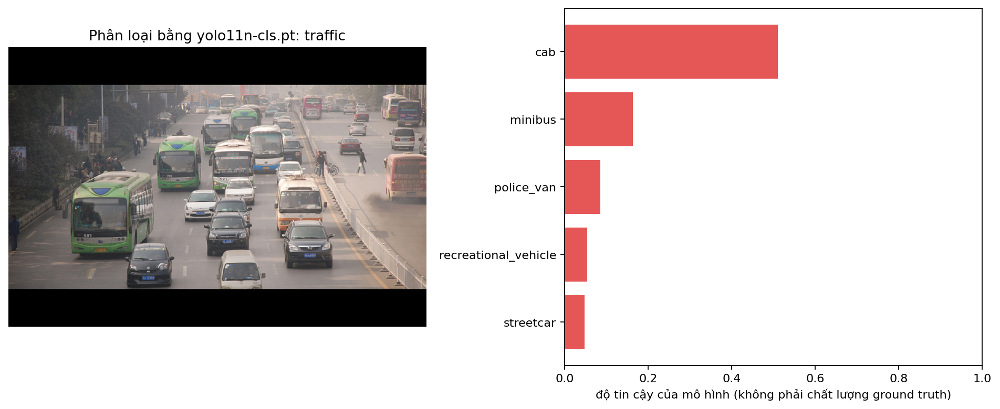
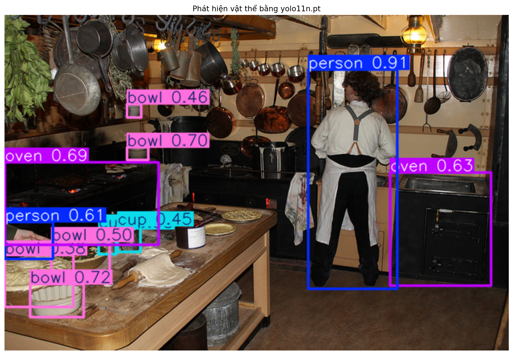
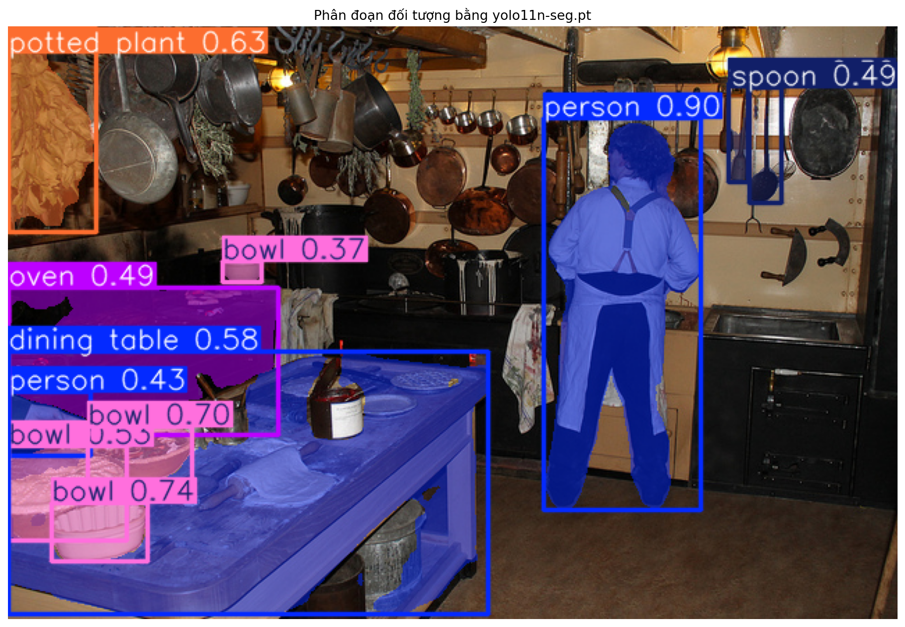

# Báo cáo bài thực hành Ngày 1 – Đọc prediction YOLO11 để hiểu định dạng nhãn

**Ngày chạy:** 2026-11-06

**Runtime Colab:** GPU (`Device: cuda`)

**Python / PyTorch / Ultralytics:** 3.13.16 / 2.11.0+cu130 / 8.4.145

**Checkpoint:** `yolo11n-cls.pt` (sha256 `c62d41bf9625…`), `yolo11n.pt` (sha256 `0ebbc80d4a76…`), `yolo11n-seg.pt` (sha256 `55ed65c56c91…`) – cả ba `PASS` checksum

**Ngưỡng detection/segmentation dùng khi tạo JSON:** `0.35`

**Thay đổi so với notebook nguồn:** Không. Ba sample `traffic` / `kitchen` / `dining` đều `PASS` checksum; ô validation báo `PASS: đủ 3 JSON, 3 PNG, attribution và instance_id duy nhất.`

### Từ cần nhớ (đọc nhanh trước khi viết)

| Từ | Nghĩa ngắn |
| --- | --- |
| Prediction | Kết quả model vừa đoán ra; chưa phải nhãn đúng |
| Ground truth | Nhãn do người gán theo quy tắc |
| Taxonomy | Danh sách tên lớp có sẵn kèm model (vd. ImageNet-1K, COCO-80) |
| Checkpoint | File model `.pt` đã huấn luyện sẵn |
| Guideline | Quy tắc gán nhãn do người viết |
| Annotator | Người gán nhãn |
| Reviewer / QC | Người kiểm tra nhãn |
| Escalation | Ca khó → hỏi Lab Coach, không tự bịa |
| Model score | Số “tin” của model; không phải điểm chất lượng nhãn người |

## 1. Phân loại ảnh

**Mở file:** `day1_lab_outputs/classification_predictions.json` và `visuals/classification_top5.png`.
Sample `traffic` (COCO 210273, 640 × 428).

1. **Record hạng 1:** `class_id`=468 ; `class_name`=`cab` ; `rank`=1 ; `score`=0.510915 ; `taxonomy_name`=`ImageNet-1K`

   Top-5 đầy đủ: `cab` 0.511 → `minibus` 0.164 → `police_van` 0.086 → `recreational_vehicle` 0.054 → `streetcar` 0.048.

   `rank` là thứ tự xếp theo `score` giảm dần trong 1000 lớp ImageNet: `rank=1` chỉ có nghĩa “model tin lớp này nhất”, không có nghĩa “đúng”. Top-5 cộng lại ≈ 0.86; 0.14 còn lại chia cho 995 lớp khác.

2. Record nói về **cả bức ảnh**. Record không có `bbox_xyxy` hay `polygon_xy`, chỉ có một danh sách xếp hạng cho toàn ảnh (`task = image_classification`). Trong ảnh thật có rất nhiều xe buýt, ô tô, người đi bộ, nhưng model chỉ trả về một phân bố lớp cho cả khung hình.
3. Danh sách lớp **đi kèm taxonomy/checkpoint** (ImageNet-1K, 1000 lớp cố định), model không tự nghĩ ra. Vì vậy ảnh COCO có nhiều xe buýt lại được xếp `cab` lên đầu: ImageNet không có lớp kiểu “traffic scene”, model buộc phải chọn trong 1000 lớp có sẵn.
4. Cần ghi đủ cả ba vì: `class_name` có thể trùng/khác nghĩa giữa các taxonomy (vd. `bus` trong COCO-80 có `class_id`=5, còn ImageNet có `minibus`, `school_bus`…); `class_id` chỉ có nghĩa khi biết nó thuộc taxonomy nào; `taxonomy_name` giúp đối chiếu, tái lập và gộp dữ liệu không nhầm lớp.
5. Guideline cần nói rõ: (a) chọn lớp theo **chủ thể chính** hay theo **ngữ cảnh/cảnh tổng thể**; (b) quy tắc ưu tiên khi có nhiều vật (vd. vật chiếm diện tích lớn nhất, hoặc vật ở tiền cảnh); (c) khi nào được dùng lớp “khác/không chắc” hoặc phải escalation; (d) nếu dự án thực chất cần nhiều nhãn thì phải chuyển sang multi-label, không ép single-label.
6. `score` chỉ là mức “tin” của model, có thể cao mà vẫn sai. Ở đây top-1 `cab` 0.51 trong khi vật nổi bật nhất trong ảnh là **xe buýt**. Ground truth phải do người gán theo guideline; score chỉ dùng để xếp hạng/lọc prediction hoặc ưu tiên mẫu cần review.

## 2. Phát hiện vật thể

**Mở file:** `day1_lab_outputs/detection_predictions.json` và `visuals/detection_predictions.png`.
Sample `kitchen` (COCO 397133).

1. **Một record** (`sample_id = kitchen`, ảnh 640 × 427): `class_name`=`person` ; `score`=0.912625 ; `bbox_xyxy`=[385.33, 69.24, 498.92, 348.92] ; `bbox_width`=113.58 ; `bbox_height`=279.68

2. Gốc `(0, 0)` là góc trên-trái ảnh, đơn vị pixel. Góc trên-trái của hộp ở `(385.33, 69.24)`: cách mép trái ảnh khoảng 385 px, cách mép trên khoảng 69 px, ngay trên đầu người đầu bếp đứng quay lưng ở giữa-phải ảnh. Góc dưới-phải ở `(498.92, 348.92)`, ngang mức chân chạm sàn. Hộp rộng 498.92 − 385.33 ≈ 113.58 px và cao 348.92 − 69.24 ≈ 279.68 px; hộp cao gấp khoảng 2.5 lần bề rộng vì người đứng thẳng.
3. Số prediction trên `kitchen` theo ngưỡng (output ô so sánh):

   | Ngưỡng | Số prediction | Lớp |
   | ---: | ---: | --- |
   | 0.20 | 17 | person×2, bowl×5, oven×2, cup×2, spoon×3, potted plant, dining table, bottle |
   | 0.35 | 11 | person×2, bowl×5, oven×2, cup×2 |
   | 0.60 | 6 | person×2, bowl×2, oven×2 |

4. Khi hạ ngưỡng từ 0.35 xuống 0.20, có thêm 6 hộp (`spoon`×3, `potted plant`, `dining table`, `bottle`). Reviewer phải kiểm từng hộp mới: đúng hay false positive (vd. bó lá treo bên trái bị gọi `potted plant`, dụng cụ treo tường bị gọi `spoon`), hộp trùng lặp, lớp có nằm trong taxonomy dự án không. Khối lượng review tăng và cần ghi lý do loại bỏ.
5. **Quy tắc box:** “Vẽ một hộp chữ nhật ôm sát **phần nhìn thấy** của mỗi vật thuộc danh sách lớp, cạnh hộp chạm điểm ngoài cùng của vật, không chừa nền thừa. Mỗi vật một hộp riêng, kể cả khi nhiều vật cùng lớp đứng sát nhau.”
6. Vật bị **cắt mép/che khuất**: người ở **mép trái** ảnh (`person` 0.610931, `bbox_xyxy`=[0.12, 263.18, 61.55, 310.78]). `x_min` ≈ 0 cho thấy hộp chạm mép ảnh; trên hình chỉ thấy một cánh tay thò vào khung. Đây là trường hợp lặp lại ở nhiều ảnh nên mình đưa vào **guideline**: “vật bị cắt mép vẫn gán nhãn, hộp ôm phần nhìn thấy, gắn cờ `truncated`”. Nếu dự án chưa quy định có gán người chỉ thấy một phần cơ thể hay không thì **escalation** cho Lab Coach để quyết một lần rồi bổ sung vào guideline.

## 3. Phân đoạn theo từng đối tượng

**Mở file:** `day1_lab_outputs/segmentation_predictions.json` và `visuals/segmentation_prediction.png`.
Sample `kitchen`.

1. **Một record:** `instance_id`=`kitchen-001` ; `class_name`=`person` ; `score`=0.899318 ; `polygon_point_count`=348 ; 5 điểm đầu của `polygon_xy`=[446.0, 70.0], [445.0, 71.0], [444.0, 71.0], [443.0, 72.0], [442.0, 72.0]

   (`bbox_xyxy` của instance này = [385.45, 66.44, 498.02, 348.58], gần trùng hộp detection ở mục 2.)

2. Box chỉ cho 4 số (một hình chữ nhật), luôn chứa cả nền. Polygon `kitchen-001` dùng 348 điểm; 5 điểm đầu đi dần sang trái và xuống dưới quanh đỉnh đầu (y ≈ 70–72), tức là đang bám theo đường cong của mái tóc. Polygon bám theo **đường biên thật** của vật: thấy rõ dáng người, khoảng hở giữa hai chân, phần tạp dề. Từ polygon tính được diện tích thật, hình dạng và vị trí tiếp xúc giữa các vật; box thì không.
3. `instance_id` (dạng `kitchen-NNN`) dùng để **phân biệt từng vật riêng lẻ** trong một ảnh, vd. 4–5 cái `bowl` trên bàn có cùng `class_id` nhưng mỗi cái một `instance_id`. Nó **không** phải class ID (class ID cho biết “loại gì”, instance ID cho biết “cái nào”), và **không** phải tracking ID (không bám cùng một vật qua nhiều frame video; chỉ là số thứ tự trong output lab này).
4. **Quy tắc vẽ biên mask:** “Vẽ polygon theo biên **phần nhìn thấy** của vật, đỉnh đặt sát mép (sai lệch ≤ 2–3 px). Không bao phần bị vật khác che; vật bị chia làm hai mảnh do che khuất vẫn là **một** instance. Hai vật chạm nhau phải có hai mask riêng, không chồng lấn.”
5. Chỗ khó: vùng **bàn bột bên trái** (`kitchen-005`, `dining table` 0.578416, 598 điểm polygon, `bbox_xyxy`=[0.97, 234.74, 345.86, 423.87]). Mask bàn trùm lên cả bột, chày cán, hộp mứt đặt trên bàn; mask `oven` 0.49 thì loang sang vùng tối phía sau, ranh giới với bàn và người mép trái (`person` 0.43) rất mờ. Quy tắc “không bao vật đặt lên trên” đưa vào **guideline** được. Còn việc bàn bột (bàn làm việc trong bếp) có được tính là `dining table` không là câu hỏi về **taxonomy**, nên **escalation** cho Lab Coach thay vì tự quyết.

## 4. Vòng đời và kiểm tra chất lượng

`ảnh thô → guideline → ground truth → huấn luyện → prediction → QC/rework`

| Tác vụ | Ground truth trông như thế nào? (đơn vị nhãn) | Lỗi hoặc chỗ khó quyết định bạn thấy trên ảnh/JSON | Annotator làm gì? | Reviewer xem gì? |
| --- | --- | --- | --- | --- |
| Phân loại ảnh | Một (`class_id`, `class_name`, `taxonomy_name`) cho **cả ảnh** | `traffic`: top-1 `cab` 0.511 dù chủ thể nổi bật là xe buýt; taxonomy ImageNet không có lớp “cảnh giao thông” | Chọn đúng một lớp theo quy tắc chủ thể chính; ca không có lớp phù hợp thì escalation | Lớp có đúng guideline và đúng taxonomy không; thống kê các ca bất đồng giữa annotator |
| Phát hiện vật thể | Mỗi vật một hộp `bbox_xyxy` (pixel) + lớp COCO-80 | `kitchen`: số hộp đổi 17 → 11 → 6 theo ngưỡng 0.20/0.35/0.60; bó lá treo bị gọi `potted plant`, dụng cụ treo bị gọi `spoon` ở ngưỡng 0.20; người mép trái bị cắt | Vẽ hộp sát phần nhìn thấy cho **mọi** vật trong danh sách lớp, không phụ thuộc ngưỡng; gắn cờ `truncated`/`occluded` | Hộp sót, hộp thừa/trùng, độ sát mép, lớp đúng; dùng prediction ngưỡng thấp để tìm vật có thể bị sót |
| Instance segmentation | Mỗi vật một polygon `polygon_xy` + `instance_id` riêng + lớp | `kitchen`: mask `dining table` trùm cả đồ trên bàn; mask `oven` (`kitchen-007`, 0.489667) loang; detection thấy `oven` 0.6343 bên phải ([489.09, 200.73, 617.81, 344.88]) nhưng cả 11 instance segmentation đều không có mask nào ở vùng này | Vẽ biên theo phần nhìn thấy, tách riêng từng instance chạm nhau | Biên có bám vật không, mask chồng lấn, instance bị gộp/tách sai, đối chiếu chéo với box |

**Nối vòng đời bằng evidence của lab:**

1. **Guideline:** các quy tắc ở mục 1.5, 2.5 và 3.4 (chọn lớp chủ thể chính, hộp ôm sát phần nhìn thấy, biên mask không bao vật đặt lên trên).
2. **Ground truth:** annotator gán nhãn theo guideline, độc lập với prediction. Ngưỡng 0.35 không quyết định vật nào được gán.
3. **Huấn luyện → prediction:** lab hôm nay mới ở bước này, dùng 3 checkpoint có sẵn để sinh 3 file JSON.
4. **QC/rework:** reviewer so ground truth với guideline, dùng prediction làm gợi ý chỗ cần soi (vd. `oven` 0.6343 có ở detection nhưng không có mask ở segmentation). Nhãn sai thì trả về annotator **rework**, kèm lý do. Lỗi lặp lại thì cập nhật guideline. Ca mơ hồ (bàn bột có phải `dining table` không, người chỉ thấy một cánh tay) thì escalation cho Lab Coach.

## 5. An toàn dữ liệu

1. Chỉ dùng ba ảnh COCO công khai mà notebook đã cố định bằng checksum; không tải ảnh cá nhân/nội bộ lên Colab, không ghi họ tên, MSSV hay dữ liệu cá nhân trong báo cáo và output.
2. Nếu gặp ảnh hoặc dữ liệu ngoài phạm vi (ảnh có thông tin cá nhân, dữ liệu nội bộ, checksum sai), dừng ngay, không xử lý tiếp, và báo **Lab Coach / mentor** của lớp.

## 6. Checklist trước khi nộp link repo

Kiểm tra trên GitHub trong thư mục `report/`:

- [x] `REPORT.md` (file này đã điền)
- [x] `day1_lab_outputs/classification_predictions.json`
- [x] `day1_lab_outputs/detection_predictions.json`
- [x] `day1_lab_outputs/segmentation_predictions.json`
- [x] `day1_lab_outputs/IMAGE_ATTRIBUTION.md`
- [x] `day1_lab_outputs/visuals/classification_top5.png`
- [x] `day1_lab_outputs/visuals/detection_predictions.png`
- [x] `day1_lab_outputs/visuals/segmentation_prediction.png`
- [x] Ô validation cuối notebook báo `PASS`
- [x] Không có họ tên, MSSV hoặc dữ liệu nhạy cảm trong báo cáo/output
- [ ] Đã nộp **link repository** trên LMS
